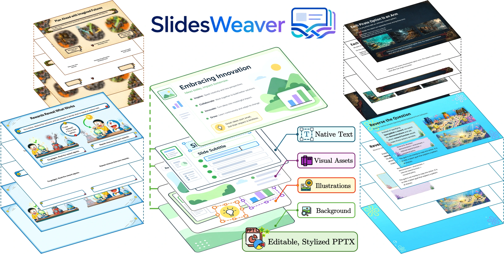
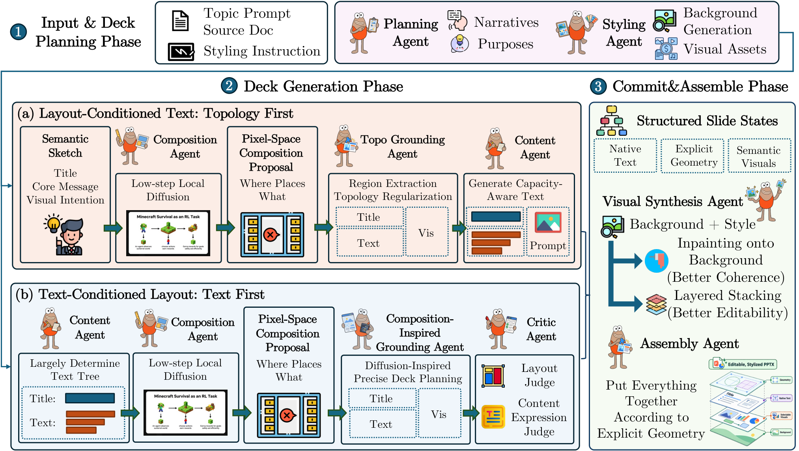

<div align="center">

<h1> SlidesWeaver</h1>

### Beyond Code and Pixels: Co-Generating Editable and Visually Rich Presentations

Official implementation of the WSDM 2027 Findings paper.

[Quick start](#quick-start) · [Two generation paths](#two-generation-paths) · [Appendix](Appendix.pdf) · [Running guide](docs/running.md) · [Architecture](docs/architecture.md) · [简体中文](README.zh-CN.md)



*Representative slides and their editable layers. Topology First examples appear on the left; Text First examples on the right.*

</div>

SlidesWeaver combines language and vision agents to turn a presentation request and a visual style into an editable PPTX deck. A lightweight local diffusion model explores composition; grounded slide representations guide visual synthesis, text fitting, and assembly. The framework provides two complementary generation schedules.

## Paper appendix

The paper's complete supplementary appendix is available in **[Appendix.pdf](Appendix.pdf)** at the repository root.

## Two generation paths

| | **Topology First** | **Text First** |
| --- | --- | --- |
| Priority | Let visual composition shape concise copy | Preserve committed text and precise geometry |
| Order | Composition → grounded topology → capacity-aware text | Text → composition inspiration → validated HTML geometry |
| Visual synthesis | Joint canvas for stronger scene integration | Registered slots and extracted visual layers |
| Implementation | [`paths/topology_first/`](paths/topology_first/) | [`paths/text_first/`](paths/text_first/) |
| Select with | `--path topology-first` | `--path text-first` |

Both paths export **native editable text**. Text First additionally places generated visual elements and holders as separate selectable raster objects. Generated artwork remains raster artwork; its internal pixels are not native PowerPoint shapes.

<div align="center">


*Shared deck planning, two generation schedules, and editable PPTX assembly.*
</div>

## Quick start

Clone the repository and run the following commands from its root:

```bash
git clone https://github.com/William030422/WSDM27-SlidesWeaver.git
cd WSDM27-SlidesWeaver
```

Live generation needs an APIMART API key, a local Z-Image-Turbo model, and a compatible NVIDIA GPU. The mock example runs without model weights, a GPU, or API calls.

**1. Install the environment.** Start with an initialized Conda shell. On Debian/Ubuntu, install the host renderer and fonts first:

```bash
sudo apt-get update
sudo apt-get install -y libreoffice-impress fontconfig fonts-noto-core fonts-noto-cjk

./scripts/setup_environment.sh
conda activate rl4ppt-final
python scripts/check_environment.py --offline
```

The setup script installs the Python/CUDA stack, Node, Chromium, and Poppler into `rl4ppt-final`. LibreOffice and fonts are host dependencies. See the [running guide](docs/running.md) for configuration and preflight details.

**2. Try an offline deck.** This exercises the selected pipeline with mock content, visuals, and diffusion proposals:

```bash
python run.py --path text-first \
  --input examples/feedback.json \
  --output-dir outputs/text_first_mock \
  --mock-api --mock-diffusion
```

Use `--path topology-first` and a separate output directory to try the other path. Mock outputs demonstrate the pipeline and editable export; the paper figures show live model generations.

**3. Configure live generation.** Copy the public template, set the API endpoint/model names and local model path, then supply your API key through the environment:

```bash
cp configs/example.conf configs/local.conf
# Edit configs/local.conf for your endpoint, models, and DIFFUSION_MODEL_PATH.
export APIMART_API_KEY="your-api-key"
python scripts/check_environment.py --model-path /path/to/Z-Image-Turbo

python run.py --path text-first \
  --config configs/local.conf \
  --input examples/feedback.json \
  --output-dir outputs/text_first_live \
  --gpu-devices 0

python run.py --path topology-first \
  --config configs/local.conf \
  --input examples/feedback.json \
  --output-dir outputs/topology_first_live \
  --gpu-devices 0
```

The default is five persistent page workers. Select GPUs with `--gpu-devices 0` or `--gpu-devices 0,1`; use `--page-workers 1` for sequential execution. Page workers share one resident diffusion process per selected GPU.

## Your input and outputs

Input JSON needs `content` and `style` strings. Include slide count, language, audience, and communication goal in the content request; [`examples/feedback.json`](examples/feedback.json) provides a complete example. The existing aliases `user_request` and `style_description` are also supported.

After full assembly, inspect:

```text
outputs/<run>/
├── assembly/
│   ├── deck.pptx                 # Editable presentation
│   ├── deck.pdf                  # Real LibreOffice render
│   ├── deck_montage.png          # Deck preview
│   └── text_fit_report.json      # Text fitting diagnostics
├── pages/                       # Per-page checkpoints
├── page_execution.json          # Ownership, timing, and reuse
└── run_manifest.json            # Completion and quality status
```

Read `quality_status` as well as `status`: `degraded` preserves useful output with reported fallbacks or unresolved quality findings. It does not certify a clean render. See [outputs and diagnostics](docs/running.md#outputs-and-diagnostics) for the route-specific render reports.

## Reuse, recovery, and verification

Rerun the same command to reuse matching checkpoints. Use `--start-at` and `--stop-after` to inspect or resume a stage; keep the same input, configuration, and output directory. [The running guide](docs/running.md#stages-and-resume) lists valid stage names for each path.

```bash
python scripts/run_tests.py --path all
python scripts/verify_provenance.py
```

The tests cover configuration, layout, fitting, recovery, and editable export.
See [validation](RESULTS.md) for checks and known limitations. Live model
responses can vary; compare exports using the same plans, assets, fonts, and
renderer versions.

## Inside the framework

```text
SlidesWeaver/
├── run.py                       # Shared path selector
├── paths/
│   ├── topology_first/          # Topology-led generation and assembly
│   └── text_first/              # Text-led HTML grounding and layered assembly
├── configs/                     # Public configuration templates
├── examples/                    # Presentation requests
├── scripts/                     # Setup, preflight, and validation
└── docs/                        # Architecture, operation, and paper figures
```

See the [architecture guide](docs/architecture.md) for the two generation paths and the [running guide](docs/running.md) for recovery and troubleshooting.
