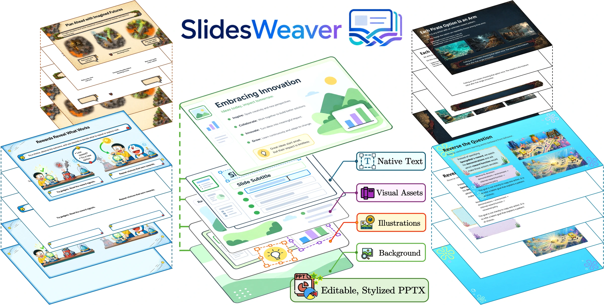
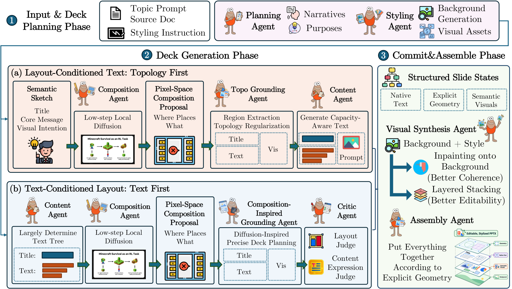

<div align="center">

<h1> SlidesWeaver</h1>

### Beyond Code and Pixels: Co-Generating Editable and Visually Rich Presentations

WSDM 2027 Findings 论文的官方实现。

[English](README.md) · [论文 Appendix](Appendix.pdf) · [运行详解](docs/running.md) · [框架结构](docs/architecture.md)



</div>

SlidesWeaver 将语言模型、视觉模型与确定性排版结合，把内容需求和风格描述转换为可编辑 PPTX。两条路径分别保存于独立目录，共用统一运行入口。

## 论文 Appendix

论文的完整补充材料保存在仓库根目录：**[查看 Appendix.pdf](Appendix.pdf)**。

| 路径 | 适用需求 | 核心过程 | 代码目录 |
| --- | --- | --- | --- |
| **Topology First** | 希望构图先行，文字能够适应空间容量 | 扩散构图 → 拓扑落地 → 文本生成 → 整体画面合成 | [`paths/topology_first/`](paths/topology_first/) |
| **Text First** | 更重视既定文字与精确布局 | 文本确定 → 扩散构图参考 → HTML 几何校验 → 分层合成 | [`paths/text_first/`](paths/text_first/) |

两条路径都保留原生可编辑文本。Text First 还把视觉元素和文字承托装饰作为独立图片对象放入 PPTX，便于移动、缩放和替换；图片内部的绘画内容仍是栅格图像。

<div align="center">

</div>

## 安装

克隆仓库后，以下命令均在仓库根目录运行：

```bash
git clone https://github.com/William030422/WSDM27-SlidesWeaver.git
cd WSDM27-SlidesWeaver
```

先准备可用且已初始化的 Conda。Debian/Ubuntu 上先安装宿主机依赖：

```bash
sudo apt-get update
sudo apt-get install -y libreoffice-impress fontconfig fonts-noto-core fonts-noto-cjk

./scripts/setup_environment.sh
conda activate rl4ppt-final
python scripts/check_environment.py --offline
```

安装脚本统一配置 Python/CUDA、Node、Chromium 和 Poppler。LibreOffice 用于真实 PPTX → PDF 渲染；字体影响实际文字宽度与换行，因此需要保留预检要求的字体。

## 先运行无需 API 的示例

```bash
python run.py --path text-first \
  --input examples/feedback.json \
  --output-dir outputs/text_first_mock \
  --mock-api --mock-diffusion

python run.py --path topology-first \
  --input examples/feedback.json \
  --output-dir outputs/topology_first_mock \
  --mock-api --mock-diffusion
```

Mock 模式无需 API key、本地模型权重或 GPU，仍需要导出依赖。它用于检查流程、文件交接和可编辑导出；README 配图来自论文中的真实模型生成结果。

## 运行真实生成

准备 APIMART API key、可用的模型名称、本地 Z-Image-Turbo 模型与兼容 NVIDIA GPU。根据配置模板填写本地设置。

```bash
cp configs/example.conf configs/local.conf
# 编辑 configs/local.conf：填写 API 地址、模型名称和 DIFFUSION_MODEL_PATH。
export APIMART_API_KEY="your-api-key"
python scripts/check_environment.py --model-path /path/to/Z-Image-Turbo

python run.py --path text-first \
  --config configs/local.conf \
  --input examples/feedback.json \
  --output-dir outputs/text_first_live \
  --gpu-devices 0

python run.py --path topology-first \
  --config configs/local.conf \
  --input examples/feedback.json \
  --output-dir outputs/topology_first_live \
  --gpu-devices 0
```

默认并行处理五页，`--page-workers 1` 可切换为顺序执行。`--gpu-devices 0,1` 可选择多张 GPU；每张 GPU 只驻留一个扩散模型进程，其余页面工作可与 API 请求并行。

输入 JSON 使用 `content` 和 `style` 两个字符串；在内容需求中写清页数、语言、受众和表达目标。也兼容旧字段 `user_request`、`style_description`。参见 [`examples/feedback.json`](examples/feedback.json)。

## 结果与恢复

完整运行后的主要结果位于：

- `outputs/<run>/assembly/deck.pptx`：可编辑演示文稿。
- `outputs/<run>/assembly/deck.pdf`：LibreOffice 真实渲染结果。
- `outputs/<run>/assembly/deck_montage.png`：整套预览。
- `outputs/<run>/assembly/text_fit_report.json`：文字适配检查。
- `outputs/<run>/run_manifest.json`：运行与质量状态。

`status` 表示流程完成情况；还需检查 `quality_status`。`degraded` 表示结果已保留，但存在回退、修复或尚未解决的质量问题，具体原因写入报告。

相同命令再次运行会复用匹配的检查点。使用 `--start-at` / `--stop-after` 可指定阶段恢复或提前停止；两条路径的阶段名称不同，详见[阶段与恢复说明](docs/running.md#stages-and-resume)。

```bash
python scripts/run_tests.py --path all
python scripts/verify_provenance.py
```

测试覆盖配置、布局、文字适配、断点恢复和可编辑导出，详见[验证说明](RESULTS.md)。实时模型响应可能不同；对比导出结果时，应固定规划、素材、字体和渲染器版本。

更详细的配置、故障排查与输出说明见[运行指南](docs/running.md)。
