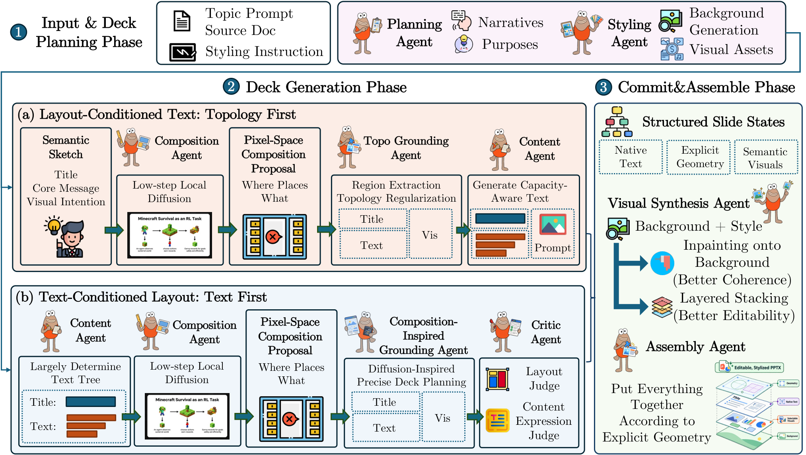

# Architecture

SlidesWeaver coordinates content, composition, geometry, and appearance through staged commitments. Both generation paths begin with deck-level narrative and visual planning, use a lightweight local diffusion proposal, and finish with deterministic editable PPTX assembly.

## Topology First: layout-conditioned text

1. Plan the deck and generate a canonical style background and reusable visual resources.
2. Reduce each slide's semantic intent to a lightweight composition request.
3. Generate a local diffusion skeleton at `1024x576`.
4. Ground its regions and relationships into a topology with coarse spatial scaffolds and capacity hints.
5. Generate concise copy and visual briefs conditioned on those regions.
6. Synthesize the final visual canvas with soft spatial controls at `1536x864`.
7. Fit editable text, holders, and decorations as content units; apply bounded review patches and export.

The relational topology is the commitment. Metric positions can adapt to the realized visual canvas. This gives composition a stronger role in the final expression and allows scene-level texture, light, and decoration to remain coherent.

The implementation resides in `paths/topology_first/`. Its optional combination-background export reconstructs a companion deck from the canonical background and coarse movable difference modules. Those modules are raster objects.

## Text First: text-conditioned layout

1. Plan the deck and commit a canonical text tree.
2. Generate the canonical deck background and concise expression logic.
3. Give local diffusion the title, communicative intent, and expression logic, while withholding detailed body copy.
4. Ground the composition reference together with committed text into HTML; render and refine the plan under content and geometry guards.
5. Commit browser-derived geometry and rich-text structure.
6. Generate registered visual and holder slots; apply slot-aware chroma matting to extract transparent assets.
7. Place the background, assets, native text, and supported native connectors into the PPTX at committed coordinates; audit the real PDF render.

Here, the diffusion image is advisory. HTML provides authoritative geometry after validation, while text guards restrict semantic drift. Final image generation cannot redefine that geometric contract.

The implementation resides in `paths/text_first/`.

## What remains editable

| Layer | Result |
| --- | --- |
| Slide text | Native PowerPoint text, including supported rich text and bullets |
| Native geometry | Supported shapes/connectors remain native objects |
| Text First visuals and holders | Independently selectable raster assets |
| Topology First scene | Integrated raster canvas with editable text overlays |
| Canonical background | Raster image |

The framework targets layered editability. It does not reconstruct every brushstroke or illustration component as a vector shape.

## Execution and recovery

Five persistent page owners are the default. Shared deck decisions happen once, and page-level calls overlap after those decisions are available. Each selected GPU runs one persistent diffusion process with a queue; page ownership is independent of GPU capacity.

Both implementations retain stage checkpoints, input fingerprints, saved model responses, image task journals, output locks, and timing records. Text First has a shared typography commitment; Topology First has a deck-wide holder-family decision. Final assembly consumes accepted page plans in slide order.

Unknown image-submission outcomes require reconciliation rather than an automatic duplicate paid submission. Missing derived assets can be rebuilt from saved generation artifacts when the route supports it. See [the running guide](running.md#stages-and-resume).

## Configuration and rendering

Each route has its own prompts, stage logic, and renderer. The root runner selects the route, reads the chosen configuration, and resolves input and output paths.

Live LLM, VLM, and image responses depend on sampling and provider settings. Deterministic export comparisons require fixed composition plans, image assets, fonts, and renderer versions. Mock runs exercise orchestration and export with synthetic inputs.
